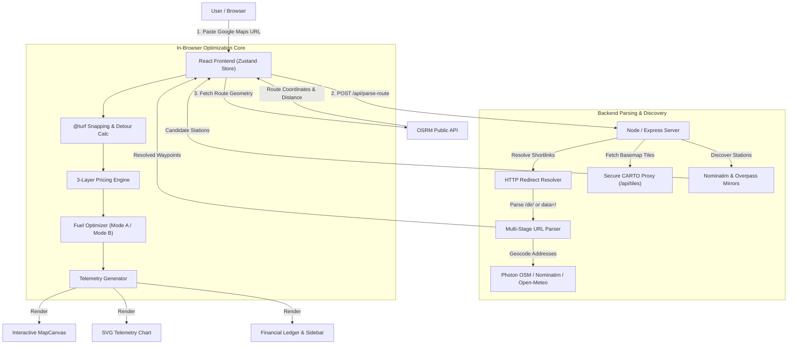

# FuelOptima ⛽

> **Smart road-trip refueling planner for North America—find where to stop, how much fuel to buy, and how much you'll save.**

FuelOptima helps drivers across Canada and the US spend less on gas on long highway drives. Paste a Google Maps directions link (or pick a sample trip), choose your vehicle, and FuelOptima finds the cheapest gas stations along your route—balancing pump prices against detour time and your tank's safety reserves.

[Overview](#overview) · [Features](#features) · [Architecture](#architecture) · [Math & Optimization](#mathematical-formulation) · [Limitations](#known-limitations) · [Getting Started](#getting-started) · [Demo Trips](#preloaded-demo-trips)

---

## Overview

Gas prices can vary by 20% or more along a single highway—between cities and rural exits, across state or provincial borders, and between expensive highway service plazas and nearby discount stations. Standard map apps only show what's closest right now, not what makes the whole trip cheapest.

FuelOptima plans your fuel stops across the entire drive:
- **Lowers total trip cost** by skipping pricey stops and filling up where gas is cheaper ahead.
- **Avoids long detours** by filtering out stations too far off the highway.
- **Protects your safety buffer** so your tank never drops below your minimum reserve mid-trip or at arrival.
- **Shows the full picture** with an interactive map, a live fuel-level graph, and a stop-by-stop cost breakdown.

---

## Features

- **Google Maps Link Import**: Paste desktop, mobile, or shortened (`maps.app.goo.gl`) Google Maps directions links to route along drivable highways (with an offline fallback) and discover stations along the corridor.
- **Two Refueling Strategies**:
  - **Mode A — Fill-to-Full / Dollar Cap**: Fills the tank to 100% (or a max dollar cap) at each stop.
  - **Mode B — Minimum Cost (Partial Refill)**: Buys just enough expensive fuel to reach a cheaper station ahead.
- **Interactive Map & Fuel Graph**: Color-coded station pins, detour corridor buffer, red warnings for unreachable fuel gaps ("dead zones"), and a synchronized fuel-level chart you can scrub across the trip.
- **Official Vehicle Specs (2015–2026)**: Built-in US (DOE) and Canadian (NRCan) highway/city ratings and tank capacities, plus a custom vehicle option.
- **Dual Units & Filtering**: Instant switch between Metric (`km`, `L`, `$/L`) and Imperial (`mi`, `gal`, `$/gal`), brand exclusions (e.g., Costco), and CSV price import/export.

### 3-Layer Hybrid Fuel Pricing Engine

Because live pump prices aren't freely available via public APIs, FuelOptima estimates station prices in three layers—and lets you click any station to enter exact prices or import a CSV:

```
┌────────────────────────────────────────────────────────┐
│  Layer 1: Macro Regional Baseline / 3-Zone Pricing     │
│  (Start Zone, Mid-Corridor Zone, End-Destination Zone) │
└───────────────────────────┬────────────────────────────┘
                            │
┌───────────────────────────▼────────────────────────────┐
│  Layer 2: Brand & Location Heuristic Modifiers         │
│  • Discount Brands (Costco, Pioneer, Arco, etc.)       │
│  • Premium Brands (Shell, Chevron, Petro-Canada, etc.) │
│  • Highway Service Plazas (ONroute markup)             │
│  • Highway Proximity Markup (<= 0.2 mi / 330m)         │
└───────────────────────────┬────────────────────────────┘
                            │
┌───────────────────────────▼────────────────────────────┐
│  Layer 3: Manual Crowd-Style Overrides                 │
│  • In-place UI price editing                           │
│  • Bulk CSV station pricing import & export            │
└────────────────────────────────────────────────────────┘
```

---

## Architecture



- **State & Recalculation**: Zustand (`src/store/useTripStore.ts`) keeps parameters reactive—changing your vehicle, reserves, pricing, or detour limit re-runs the optimizer and updates the map, chart, and ledger in under 10 ms.
- **Tile Proxy**: `server.ts` proxies CARTO basemap requests via `/api/tiles/:style/:z/:x/:y.png` so API keys stay on the server (falling back to OpenStreetMap for street tiles if unconfigured).

<details>
<summary>Project Structure</summary>

```
FuelOptima/
├── server.ts                         # Express backend (URL parsing, station discovery, tile proxy, Vite)
├── scripts/seed-vehicles.ts          # Compiles NRCan/DOE fuel rating CSVs into JSON
└── src/
    ├── App.tsx                       # Main layout
    ├── store/useTripStore.ts         # Zustand state store & reactive solver pipeline
    ├── types/trip.ts                 # Shared TypeScript interfaces
    ├── components/                   # TopBar, LeftSidebar, MapCanvas, TelemetryChart, SettingsModal, OnboardingModal
    ├── data/                         # demoTrips.ts, vehicles.json, vehicles.fallback.json, rating CSVs
    └── lib/
        ├── units.ts                  # Metric / Imperial & currency conversions
        ├── geo/                      # urlParser.ts, osrm.ts, overpass.ts
        ├── pricing/pricingEngine.ts  # 3-layer pricing model & CSV import/export
        └── optimizer/                # fuelOptimizer.ts & fuelOptimizer.test.ts
```

</details>

---

## Mathematical Formulation

### Fuel Consumption (Highway vs. City)
Highway cruising ($v \ge 80\text{ km/h}$) uses the vehicle's **Highway Rating** ($R_{\text{hwy}}$ in L/100km), while the first and last $8\text{ km}$ urban zones and off-highway station detours use the **City Rating** ($R_{\text{city}}$ in L/100km):

$$\text{Fuel}_{\text{burn}} = \left( \frac{d_{\text{highway}}}{100} \times R_{\text{hwy}} \right) + \left( \frac{d_{\text{urban}} + d_{\text{detour}}}{100} \times R_{\text{city}} \right)$$

### Detour Penalty Modeling
Off-highway detours model a 1.3× road winding factor, 56 km/h driving speed plus 1.2 min pump time, city-rate detour fuel burn, and an optional time weight ($W_{\text{detour}}$, e.g. `$0.25/min`):

$$\text{Detour Distance (km)} = \text{StraightLineDist} \times 1.3 \times 2$$

$$\text{Detour Time (min)} = \left( \frac{\text{Detour Distance}}{56} \times 60 \right) + 1.2$$

### Mode A: Discretized Dynamic Programming (Fill-to-Full / Dollar Cap)
Models drivers who fill to capacity $C$ (or a per-stop spending cap) using a shortest-path DP across stations $S_i$ and $0.5\text{ L}$ fuel buckets. A transition $S_i \to S_j$ is valid iff:

$$F_{\text{departure}}(S_i) - \text{FuelBurn}(S_i \to S_j) \ge F_{\text{min\_stop}}$$

Fuel purchased at $S_j$ and the cost-minimizing recurrence:

$$\Delta F = \min\left( C - F_{\text{arrival}}(S_j), \frac{\text{MaxDollarPerStop}}{P_j} \right)$$

$$\text{Cost}(S_j) = \min_{S_i} \left[ \text{Cost}(S_i) + (\Delta F \times P_j) + (\text{DetourMinutes}_j \times W_{\text{detour}}) \right]$$

### Mode B: Greedy Lookahead (Variable Partial Refill)
Minimizes total cost by adjusting purchase volume at each stop $S_{\text{curr}}$:
1. **Cheaper station ahead ($S_{\text{next}}$ within range)**: Buy only enough fuel to reach $S_{\text{next}}$ with reserve $F_{\text{min\_stop}}$:

$$F_{\text{target}} = \text{FuelNeeded}(S_{\text{curr}} \to S_{\text{next}}) + F_{\text{min\_stop}}$$

2. **Cheapest in range (destination unreachable)**: Fill to tank capacity $C$ (or the per-stop dollar cap).
3. **Destination reachable**: Buy the exact fuel required to arrive with target reserve $F_{\text{target\_end}}$.

### Dead Zone & Feasibility Checks
Before solving, FuelOptima checks starting fuel to the first station, consecutive station gaps against max usable range ($C - F_{\text{min\_stop}}$), and arrival reserve reachability—returning structured errors and highlighting unreachable segments in red on the map.

---

## Known Limitations

- **OSRM vs. Google Maps Paths**: Routes are recomputed from extracted waypoints via OSRM/OpenStreetMap, so geometry may differ slightly from Google Maps' live-traffic or toll diversions.
- **Estimated Pump Prices**: OpenStreetMap lacks live retail prices; FuelOptima uses zone/brand/proximity heuristics unless you edit prices manually or upload a CSV.
- **Public API Rate Limits**: OSRM, Nominatim, and Overpass are community services that can throttle under load (an offline geodesic spline fallback preserves routing).
- **Gas/Hybrid Focus & Nominal Conditions**: Does not model EV charging curves, real-time traffic jams, or weather effects on consumption.

---

## Getting Started

**Prerequisites**: Node.js v18+ (v20+ recommended) and `npm` or `bun`.

```bash
git clone https://github.com/your-username/fueloptima.git
cd fueloptima
npm install
npm run dev
```

Open **`http://localhost:3000`**.

- **Optional `.env`**: Set `PORT=3000` and `CARTO_API_KEY=...` (see [`.env.example`](.env.example); street tiles fall back to OpenStreetMap if omitted).
- **Checks & Data**:
  ```bash
  npm run lint                                         # TypeScript check
  npx tsx --test src/lib/optimizer/fuelOptimizer.test.ts  # Unit tests
  npm run seed:vehicles                                # Re-seed vehicles.json from CSVs
  ```

---

## Preloaded Demo Trips

Three built-in corridors work out of the box with pre-cached stations and pricing:

| Preset | Corridor | Distance | Units | Highlights |
| :--- | :--- | :--- | :--- | :--- |
| **Toronto to Montreal** | Highway 401 & Autoroute 20 | 542 km | Metric (`$/L`) | ON vs. QC pricing; ONroute plazas vs. off-exit discount hubs |
| **Los Angeles to Las Vegas** | I-15 Freeway | 270 mi | Imperial (`$/gal`) | California border prices vs. Nevada discount stations |
| **Toronto to New York City** | QEW / I-90 / I-81 / I-80 | 492 mi | Cross-Border (`$/gal`) | Canada–US cross-border fuel price arbitrage |

---

## License

Distributed under the **MIT License**.
