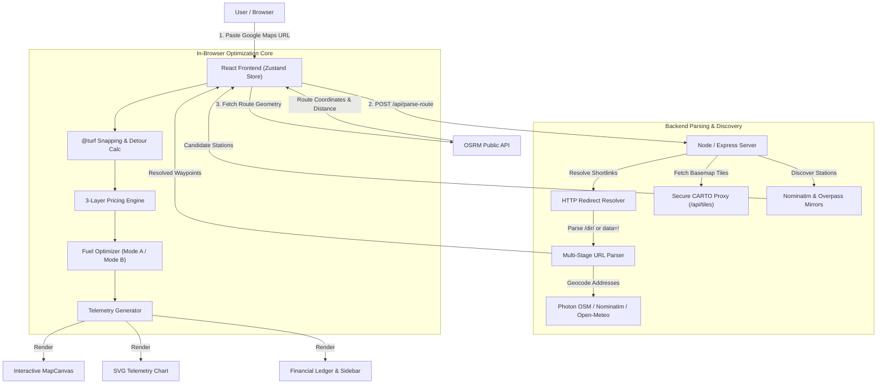

# FuelOptima ⛽

> **Intelligent Geospatial & Financial Refueling Optimizer for North American Road Trips**

FuelOptima is a high-performance web application designed to solve the **Fixed-Path Refueling Problem (FPRP)** along long-distance North American highway corridors (Canada & the United States). By combining geospatial corridor analysis, dual-rating fuel consumption modeling, and a 3-layer hybrid pricing engine, FuelOptima calculates the mathematically optimal refueling schedule—identifying exactly where to stop, how much fuel to purchase, and how much money is saved compared to naive refueling habits.

---

## Table of Contents

1. [Overview & Motivation](#overview--motivation)
2. [Key Features](#key-features)
   - [Google Maps Directions URL Ingestion](#1-google-maps-directions-url-ingestion)
   - [OSRM & Geodesic Highway Routing](#2-osrm--geodesic-highway-routing)
   - [Live Corridor Station Discovery](#3-live-corridor-station-discovery)
   - [3-Layer Hybrid Fuel Pricing Engine](#4-3-layer-hybrid-fuel-pricing-engine)
   - [Dual-Policy Refueling Optimization Engine](#5-dual-policy-refueling-optimization-engine)
   - [Fuel Telemetry & Interactive Visualizations](#6-fuel-telemetry--interactive-visualizations)
   - [Official North American Vehicle Database](#7-official-north-american-vehicle-database)
   - [Dual Unit & Currency Localization](#8-dual-unit--currency-localization)
3. [System Architecture & Design](#system-architecture--design)
   - [High-Level Architectural Flow](#high-level-architectural-flow)
   - [Component & Directory Structure](#component--directory-structure)
   - [State Management & Data Flow](#state-management--data-flow)
   - [Security & Tile Proxying](#security--tile-proxying)
4. [Mathematical & Algorithmic Formulation](#mathematical--algorithmic-formulation)
   - [Fuel Consumption Model (Highway vs. City)](#fuel-consumption-model-highway-vs-city)
   - [Detour Penalty Modeling](#detour-penalty-modeling)
   - [Mode A: Discretized Dynamic Programming (Fill-to-Full / Dollar Cap)](#mode-a-discretized-dynamic-programming-fill-to-full--dollar-cap)
   - [Mode B: Greedy Lookahead (Variable Partial Refill)](#mode-b-greedy-lookahead-variable-partial-refill)
   - [Dead Zone Detection & Feasibility Proofs](#dead-zone-detection--feasibility-proofs)
5. [Known Limitations & Technical Nuances](#known-limitations--technical-nuances)
6. [Getting Started & Local Setup](#getting-started--local-setup)
   - [Prerequisites](#prerequisites)
   - [Installation](#installation)
   - [Environment Variables](#environment-variables)
   - [Running the Application](#running-the-application)
   - [Running Tests & Typechecking](#running-tests--typechecking)
   - [Re-seeding Vehicle Specifications](#re-seeding-vehicle-specifications)
7. [Preloaded Demo Trips](#preloaded-demo-trips)
8. [License](#license)

---

## Overview & Motivation

Fuel prices fluctuate dramatically across state and provincial boundaries, between urban hubs and rural highway corridors, and among competing fuel brands. For example, a traveler driving from Toronto to Montreal along Highway 401 may encounter regular unleaded gasoline varying between **$1.45/L** and **$1.75/L**—a difference of over 20%. Similarly, driving from Los Angeles to Las Vegas along the I-15 corridor reveals price swings between California border stations and Nevada discount hubs of over **$1.00/gal**.

Most navigation apps (Google Maps, Apple Maps, Waze) direct drivers to stations based purely on immediate proximity or ad placement, often recommending expensive highway service plazas or requiring unnecessary detours.

**FuelOptima** bridges this gap by formulating refueling as a constrained mathematical optimization problem:
- **Minimizes Total Expenditure**: Balances fuel purchase costs against detour time and vehicle consumption.
- **Enforces Safety Reserves**: Never allows the fuel tank to drop below a user-defined minimum threshold (e.g., 15%) or arrive at the destination below a targeted reserve (e.g., 25%).
- **Respects Detour Tolerances**: Filters out stations that stray too far from the highway corridor.
- **Provides Transparent Telemetry**: Visualizes remaining fuel, step-by-step financial ledgers, and savings vs. naive baseline refueling.

---

## Key Features

### 1. Google Maps Directions URL Ingestion
Users can paste standard desktop, mobile, or shortened Google Maps directions URLs directly into the application:
- **Supported URL Types**:
  - Full desktop directions: `https://www.google.com/maps/dir/Toronto,+ON/Montreal,+QC/@44.5,-76.5,8z/...`
  - URL query formats: `https://maps.google.com/?saddr=Toronto&daddr=Montreal` or `...&origin=...&destination=...&waypoints=...`
  - Shortened mobile links: `https://maps.app.goo.gl/...`, `goo.gl/maps/...`, and `g.co/maps/...` (automatically followed and resolved on the backend).
- **Multi-Stage Extraction Pipeline**:
  - **Stage A (Explicit Coordinates)**: Parses explicit `lat,lng` segments or decodes sequence coordinates from Google's internal `data=!1m5!2m2!1d<lng>!2d<lat>!3d<lat>!4d<lng>` protobuf tokens, deduplicating redundant waypoint pairs.
  - **Stage B (Address Geocoding)**: When text addresses or place names are present, progressively simplifies place strings (stripping Google Plus codes, postal codes, and unit/suite numbers) and queries a resilient open-source geocoding pipeline (**Photon OSM** &rarr; **Nominatim OSM** &rarr; **Open-Meteo** &rarr; internal city coordinates dictionary).
  - **Hybrid Stage**: Handles mixed routes where some stops are GPS coordinates and others are business names or street addresses.

### 2. OSRM & Geodesic Highway Routing
- Converts resolved waypoints into a drivable route using the public **Open Source Routing Machine (OSRM)** driving API (`router.project-osrm.org`).
- Decodes polyline geometries into GeoJSON coordinates, distance metrics, bounding boxes, and duration estimates.
- **Resilient Offline Fallback**: If external OSRM endpoints rate-limit or experience downtime, FuelOptima automatically engages a Turf.js-powered geodesic spline highway interpolation with a calibrated 1.14x highway winding factor, ensuring the application remains functional offline.

### 3. Live Corridor Station Discovery
- **High-Density Spatial Search**: Queries OpenStreetMap Nominatim and Overpass API mirrors (`overpass.private.coffee`, `overpass.kumi.systems`, `overpass-api.de`) for fuel stations located within the highway corridor.
- **Dynamic Isochrone Buffer**: Calculates the maximum search radius from the user's detour time constraint and projects a spatial bounding envelope around the route.
- **Route Snapping**: Uses `@turf/nearest-point-on-line` to project each station onto the 1D route polyline, measuring:
  - Exact distance along the route (`distanceAlongRouteKm`)
  - Straight-line distance from the freeway (`straightLineDistKm`)
  - Round-trip detour distance (`detourDistanceKm = straightLineDistKm * 1.3 * 2`)
  - Round-trip detour driving time (`detourTimeMinutes`)
- **Brand Omission & Filtering**: Users can exclude specific brands (e.g., membership-only stations like Costco or Sam's Club, or brands they do not prefer) from the candidate set with a single click.

### 4. 3-Layer Hybrid Fuel Pricing Engine
Because real-time retail pump prices across tens of thousands of North American stations are locked behind proprietary commercial APIs, FuelOptima uses an industry-calibrated 3-layer hybrid pricing model:

```
┌────────────────────────────────────────────────────────┐
│  Layer 1: Macro Regional Baseline / 3-Zone Pricing     │
│  (Start Zone, Mid-Corridor Zone, End-Destination Zone) │
└───────────────────────────┬────────────────────────────┘
                            │
┌───────────────────────────▼────────────────────────────┐
│  Layer 2: Brand & Location Heuristic Modifiers         │
│  • Discount Brands (Costco, Pioneer, Arco, etc.)       │
│  • Premium Brands (Shell, Chevron, Petro-Canada, etc.) │
│  • Highway Service Plazas (ONroute markup)             │
│  • Highway Proximity Markup (<= 0.2 mi / 330m)         │
└───────────────────────────┬────────────────────────────┘
                            │
┌───────────────────────────▼────────────────────────────┐
│  Layer 3: Manual Crowd-Style Overrides                 │
│  • In-place UI price editing                           │
│  • Bulk CSV station pricing import & export            │
└────────────────────────────────────────────────────────┘
```

- **Layer 1 (Macro Regional Baseline)**: Divides the trip into three regional zones (`start`, `mid`, `end`), allowing users or presets to model known price variances across provincial/state lines (e.g., Ontario vs. Quebec, California vs. Nevada).
- **Layer 2 (Brand & Location Heuristics)**:
  - **Discount Brands** (-$0.07/L in Canada or -$0.20/gal in the US): Costco, Canadian Tire Gas+, Pioneer, Ultramar, Arco, Sam's Club, Buc-ee's.
  - **Premium Brands** (+$0.02/L in Canada or +$0.08/gal in the US): Shell, Chevron, Petro-Canada, Mobil, Exxon.
  - **Highway Service Centres** (+$0.06/L): ONroute plazas and toll road service centers.
  - **Proximity Penalty** (+$0.01/L or +$0.05/gal): Stations immediately adjacent to highway off-ramps (within 0.2 miles / 330m) receive a convenience markup over local town stations.
- **Layer 3 (Manual Crowd Overrides)**: Users can click any station on the map or in the list to input an exact known price, or import/export a CSV ledger of station prices.

### 5. Dual-Policy Refueling Optimization Engine
FuelOptima offers two distinct mathematical optimization modes:

1. **Mode A — Strict Fill-to-Full / Dollar Cap Policy (Discretized Dynamic Programming)**:
   - Reflects the practical driver habit of filling the tank to 100% capacity at every stop (or adding the maximum fuel allowed under a per-stop dollar cap).
   - Formulates the problem as a shortest-path Dynamic Program across discrete fuel states, evaluating optimal station transition sequences.
2. **Mode B — True Minimum Cost / Variable Refill Policy (Greedy Lookahead / LP)**:
   - Solves the classic Operations Research Fixed-Path Refueling Problem.
   - Allows partial refills: if an expensive station must be visited to avoid running out of fuel, the driver purchases only enough fuel to reach a cheaper station downstream.
   - At cheap stations, fills to capacity. At the final stop, purchases the exact fuel required to arrive at the destination with the targeted reserve.

### 6. Fuel Telemetry & Interactive Visualizations
- **Continuous Telemetry Chart**: An interactive SVG area/line graph tracking fuel levels from departure to destination. Shows:
  - Sloping fuel burn over highway cruising segments.
  - Steeper burn during urban driving and off-highway detours.
  - Vertical leaps at refueling stops annotated with fuel added and price paid.
  - Minimum Station Reserve line and Target Arrival Reserve line.
  - Hover synchronization: scrub over any point on the chart to inspect distance, remaining volume, percentage, and map position.
- **Slippy Basemap Canvas**:
  - Custom Mercator projection engine rendering styled CARTO tiles (Dark Matter, Voyager Streets), OpenStreetMap, and ESRI World Imagery.
  - Visualized isochrone corridor buffer representing search limits.
  - Station markers color-coded by tier (green for discount, amber for standard, purple for premium, orange for highway plazas) and stop status (pulsing emerald rings for selected optimal stops).
  - Unreachable dead-zone route segments highlighted in crimson red.
- **Financial Ledger**:
  - Detailed summary cards: Total Cost, Fuel Purchased, Fuel Burned, Detour Minutes, and Financial Savings vs. Naive Baseline.
  - Step-by-step turn sheet detailing arrival fuel, fuel purchased, departure fuel, leg distance, detour metrics, step cost, and the mathematical policy reasoning behind each decision.

### 7. Official North American Vehicle Database
- **Comprehensive Vehicle Specs**: Includes hundreds of makes, models, trims, and engine configurations across model years **2015–2026**.
- **Official Open Data Sources**:
  - Natural Resources Canada (NRCan) Official Fuel Consumption Ratings.
  - US Department of Energy (FuelEconomy.gov) ratings.
- **Dual Efficiency Ratings**: Stores both Highway and City efficiency (L/100km and MPG) as well as fuel tank capacities (Liters and US Gallons).
- **Cascading Dropdowns**: Intuitive `Year` &rarr; `Make` &rarr; `Model` &rarr; `Trim` selection.
- **Custom Vehicle Override**: Drivers can toggle custom vehicle mode to manually define tank capacity and efficiency figures.

### 8. Dual Unit & Currency Localization
- **Metric System**: Kilometers (km), Liters (L), L/100km, CAD/USD ($/L).
- **Imperial System**: Miles (mi), US Gallons (gal), Miles Per Gallon (MPG), $/gal.
- Instant, loss-free toggle across the entire application interface.

---

## System Architecture & Design

### High-Level Architectural Flow



### Component & Directory Structure

```
FuelOptima/
├── server.ts                       # Express backend server (API routes, proxy, Vite middleware)
├── index.html                      # Single-page application root HTML
├── vite.config.ts                  # Vite build configuration (React, Tailwind CSS v4)
├── tsconfig.json                   # TypeScript configuration
├── package.json                    # Project dependencies and scripts
│
├── scripts/
│   └── seed-vehicles.ts            # Node script compiling official NRCan/DOE CSVs into JSON
│
├── src/
│   ├── main.tsx                    # React application entry point
│   ├── App.tsx                     # Top-level application layout
│   ├── index.css                   # Tailwind v4 utility styles and custom animations
│   │
│   ├── types/
│   │   └── trip.ts                 # Full TypeScript type definitions for routes, vehicles, optimizer
│   │
│   ├── store/
│   │   └── useTripStore.ts         # Zustand central state store & reactive recalculation hooks
│   │
│   ├── components/
│   │   ├── TopBar.tsx              # Top navigation header, view tabs, CSV export trigger
│   │   ├── LeftSidebar.tsx         # Sidebar controls (Route input, Vehicle selector, Stations, Ledger)
│   │   ├── MapCanvas.tsx           # Custom slippy map with CARTO basemaps, pins, overlays, buffers
│   │   ├── TelemetryChart.tsx      # SVG continuous fuel telemetry graph & scrub cursor
│   │   └── SettingsModal.tsx       # Modal for solver constraints, 3-zone pricing, and CSV manager
│   │
│   ├── lib/
│   │   ├── units.ts                # Unit conversion math (km/mi, L/gal, MPG/L100km, currency)
│   │   ├── geo/
│   │   │   ├── urlParser.ts        # Google Maps URL regex parsing & multi-provider geocoders
│   │   │   ├── osrm.ts             # OSRM route fetcher & offline geodesic spline fallback
│   │   │   └── overpass.ts         # Nominatim & Overpass station discovery, snapping, detours
│   │   ├── pricing/
│   │   │   └── pricingEngine.ts    # 3-Layer pricing heuristics, zone calculations, CSV parsing
│   │   └── optimizer/
│   │       ├── fuelOptimizer.ts    # Core mathematical optimization algorithms (Mode A & Mode B)
│   │       └── fuelOptimizer.test.ts # Automated unit tests for optimizer, conversions, and parser
│   │
│   └── data/
│       ├── demoTrips.ts            # Curated demo road trips (Toronto-Montreal, LA-Vegas, NY-Buffalo)
│       ├── vehicles.json           # Seeded vehicle database (2015-2026 specs)
│       └── vehicles.fallback.json  # Fallback tank capacity mapping
```

### State Management & Data Flow
The application uses **Zustand** (`src/store/useTripStore.ts`) to maintain a single source of truth:
- Whenever any parameter changes (vehicle selection, initial fuel percentage, minimum reserve, detour tolerance, pricing slider, or brand toggle), the reactive pipeline automatically:
  1. Filters corridor station candidates against detour constraints and omitted brands.
  2. Applies the 3-layer pricing engine (base zone price + brand heuristic + proximity penalty + manual overrides).
  3. Executes the mathematical optimizer (`Mode A` or `Mode B`).
  4. Generates a fresh telemetry stream of `(distance, fuelLevel, event)` tuples.
  5. Computes financial metrics against the naive baseline.
  6. Re-renders the map markers, telemetry line, and financial ledger smoothly in under **10 milliseconds**.

### Security & Tile Proxying
To ensure client-side security and avoid exposing private map keys or triggering CORS blocks:
- CARTO basemap raster tiles are requested by the client via `/api/tiles/:style/:z/:x/:y.png`.
- The Express server (`server.ts`) proxies these requests upstream to `basemaps.cartocdn.com` using the server's environment key (`CARTO_API_KEY`).
- Responses are served with long-lived HTTP caching headers (`Cache-Control: public, max-age=604800, immutable`).
- If CARTO is unreachable or no key is provided, the server automatically falls back to OpenStreetMap tiles.

---

## Mathematical & Algorithmic Formulation

### Fuel Consumption Model (Highway vs. City)
Fuel efficiency is not constant across a road trip. FuelOptima implements **Approach B (Dual-Rating Integrated Consumption)**:
- **Corridor Freeway Cruising** ($v \ge 80\text{ km/h}$): Consumes fuel at the vehicle's official **Highway Rating** ($R_{\text{hwy}}$ in L/100km).
- **Urban Route Endpoints** (the first and last 8 km of the trip entering/leaving major metropolitan centers): Consumes fuel at the **City Rating** ($R_{\text{city}}$ in L/100km).
- **Off-Highway Station Detours**: Navigating off-ramps, stoplights, commercial driveways, and gas pump queues is classified as 100% **City Driving**.

The fuel burned over a segment between distance $d_{\text{start}}$ and $d_{\text{end}}$ with detour distance $d_{\text{detour}}$ is calculated as:

$$\text{Fuel}_{\text{burn}} = \left( \frac{d_{\text{highway}}}{100} \times R_{\text{hwy}} \right) + \left( \frac{d_{\text{urban}} + d_{\text{detour}}}{100} \times R_{\text{city}} \right)$$

### Detour Penalty Modeling
To evaluate whether detouring to an off-highway station is financially worthwhile, FuelOptima models:
1. **Detour Distance**: Approximated using a 1.3 highway egress winding factor:
   $$\text{Detour Distance (km)} = \text{StraightLineDist} \times 1.3 \times 2$$
2. **Detour Time**: Modeled assuming an average off-highway driving speed of $56\text{ km/h}$ plus $1.2\text{ minutes}$ pump entry/queue time:
   $$\text{Detour Time (min)} = \left( \frac{\text{Detour Distance}}{56} \times 60 \right) + 1.2$$
3. **Detour Fuel Burned**: Fuel consumed specifically during the detour leg, calculated at the vehicle's city efficiency rating.
4. **Time Valuation Weight**: Users can set an optional cost penalty per minute of detour (e.g., $0.25/min), which is added into the solver's objective function.

### Mode A: Discretized Dynamic Programming (Fill-to-Full / Dollar Cap)
For drivers who prefer to fill their tank to 100% capacity at every stop:
- The route is discretized into a directed acyclic graph (DAG) where nodes represent stations $S_i$ and edges represent feasible driving legs between stations.
- A state is defined by the station index $i$ and discrete fuel buckets (discretized to 0.5 L intervals).
- Transitions from $S_i$ to $S_j$ are valid if and only if:
  $$F_{\text{departure}}(S_i) - \text{FuelBurn}(S_i \to S_j) \ge F_{\text{min\_stop}}$$
- At each station $S_j$, the fuel purchased is:
  $$\Delta F = \min\left( C - F_{\text{arrival}}(S_j), \frac{\text{MaxDollarPerStop}}{P_j} \right)$$
- The recurrence relation minimizes the accumulated purchase cost plus detour time penalty:
  $$\text{Cost}(S_j) = \min_{S_i} \left[ \text{Cost}(S_i) + (\Delta F \times P_j) + (\text{DetourMinutes}_j \times W_{\text{detour}}) \right]$$
- Reconstructs the optimal sequence by backtracking from the destination node.

### Mode B: Greedy Lookahead (Variable Partial Refill)
For drivers seeking the absolute minimum total expenditure by buying variable amounts of fuel:
1. **Station Selection**: Scans ahead from the current position to find all reachable candidate stations.
2. **Cheaper Station Ahead**: If a reachable station $S_{\text{next}}$ has a lower effective price than the current station $S_{\text{curr}}$, the driver purchases **only enough fuel** to reach $S_{\text{next}}$ with the safety reserve $F_{\text{min\_stop}}$:
   $$F_{\text{target}} = \text{FuelNeeded}(S_{\text{curr}} \to S_{\text{next}}) + F_{\text{min\_stop}}$$
3. **Cheapest in Range**: If no reachable station is cheaper than $S_{\text{curr}}$, but the destination cannot yet be reached, the driver fills the tank to **100% capacity** (or up to the per-stop dollar cap) to maximize driving range on the cheaper fuel.
4. **Final Refueling**: If the destination is reachable from $S_{\text{curr}}$ and no cheaper station lies ahead, the driver purchases the **exact fuel** needed to reach the destination with the targeted arrival reserve $F_{\text{target\_end}}$.

### Dead Zone Detection & Feasibility Proofs
Before executing the solver, FuelOptima verifies corridor reachability:
1. **Initial Fuel Check**: Verifies whether departure fuel can reach the first candidate station with the required safety reserve.
2. **Corridor Gap Check**: Calculates the distance between all consecutive stations along the corridor. If any gap exceeds the vehicle's maximum usable range ($C - F_{\text{min\_stop}}$), a structured `DEAD_ZONE_EXCEEDS_RANGE` error is returned.
3. **Arrival Reserve Check**: Verifies whether the vehicle can reach the destination from the final station while preserving the target arrival reserve.
4. **Visual Indicator**: Identifies the exact geographical segment where fuel would run out and renders it prominently on the map in crimson red.

---

## Known Limitations & Technical Nuances

While FuelOptima provides accurate, production-grade optimization, users and developers should be aware of several technical realities:

### 1. Route Geometry Re-computation vs. Google Maps URLs
> **Important**: FuelOptima **does not** clone or reproduce the proprietary turn-by-turn route or live traffic path generated by Google Maps.
- A Google Maps Directions URL typically contains only human-readable place strings (`/dir/Origin/Destination/`), viewpoint coordinates (`@lat,lng`), or intermediate waypoint tokens (`data=!1m5...`). It does not transmit Google's proprietary turn-by-turn navigation vectors or real-time traffic detour paths.
- FuelOptima parses the **Origin**, **Destination**, and any explicit **Waypoints** from the provided link, and then delegates the driving route calculation to **OSRM (Open Source Routing Machine)** based on OpenStreetMap highway data.
- Consequently, OSRM will compute the shortest or fastest standard driving route between those points. The resulting polyline may differ slightly from Google Maps if Google recommended a live-traffic diversion, toll bypass, or alternate highway.

### 2. Live Retail Gas Station Pricing
- OpenStreetMap and Overpass provide high-fidelity geospatial station locations, brands, and street addresses, but **do not maintain real-time retail pump prices**.
- Global live fuel price APIs (e.g., OPIS, GasBuddy, TomTom Fuel) require enterprise subscriptions with strict licensing that prohibits redistribution.
- FuelOptima overcomes this by combining macro regional baselines, brand-specific heuristic modifiers, and proximity markups. Users who want exact pump prices can enter them directly via the UI or upload a CSV file.

### 3. Public API Rate Limits & Network Dependencies
- OSRM, Nominatim, and Overpass API mirrors are free, open-source community services subject to rate limiting and temporary latency spikes.
- FuelOptima includes client-side timeouts, mirror rotation, server-side User-Agent headers, and offline geodesic spline fallbacks to maximize resilience.

### 4. Electric Vehicles (EV) & Alternative Fuels
- FuelOptima is tailored specifically for internal combustion engine (ICE) and hybrid gasoline vehicles.
- It does not currently model non-linear EV charging curves (battery pre-conditioning, charging kW tapering, state-of-charge degradation, or charger queue times).

### 5. Dynamic Weather & Live Traffic Fluctuations
- Calculations assume nominal highway conditions and standard speed limit cruising. Severe head-winds, sub-zero winter temperatures, or heavy stop-and-go traffic jams that alter instantaneous fuel consumption are not simulated in real time.

---

## Getting Started & Local Setup

### Prerequisites
- **Node.js**: v18.0.0 or higher (v20+ recommended)
- **Package Manager**: `npm` or `bun`

### Installation

```bash
# Clone the repository
git clone https://github.com/your-username/fueloptima.git
cd fueloptima

# Install dependencies
npm install
```

### Environment Variables

Create a `.env` file in the project root (optional for standard development):

```env
# Optional: CARTO API Key for high-resolution basemap tiles
CARTO_API_KEY=your_carto_api_key_here

# Server port (default: 3000)
PORT=3000
```

> **Note**: If `CARTO_API_KEY` is omitted, the tile proxy automatically falls back to OpenStreetMap standard tiles.

### Running the Application

```bash
# Start full development server (Express backend + Vite HMR frontend)
npm run dev
```

Open your browser and navigate to **`http://localhost:3000`**.

### Running Tests & Typechecking

```bash
# Run TypeScript compilation check
npm run lint

# Run automated mathematical optimizer and URL parser unit tests
npx tsx --test src/lib/optimizer/fuelOptimizer.test.ts
```

### Re-seeding Vehicle Specifications

To recompile the official Open Government Canada CSV fuel consumption ratings (2015–2026) into `src/data/vehicles.json`:

```bash
npm run seed:vehicles
```

---

## Preloaded Demo Trips

For instant demonstration without entering a Google Maps URL, the application includes four pre-configured road trips with pre-cached station corridors and pricing models:

| Preset Name | Corridor / Highways | Distance | Units | Key Demonstration |
| :--- | :--- | :--- | :--- | :--- |
| **Toronto to Montreal** | Highway 401 & Autoroute 20 | 542 km | Metric ($/L, km) | Ontario vs. Quebec regional pricing differences; ONroute highway plaza markups vs. off-highway discount hubs (Oshawa, Kingston). |
| **Los Angeles to Las Vegas** | I-15 Freeway Corridor | 270 mi | Imperial ($/gal, mi) | California border price jump vs. Nevada discount stations (Barstow, Primm, Las Vegas). |
| **New York to Buffalo** | I-87 & I-90 (NY State Thruway) | 375 mi | Imperial ($/gal, mi) | Toll road service area pricing vs. upstate New York regional exits (Syracuse, Rochester). |
| **Toronto to New York City** | Cross-Border (Hwy 405, I-90, I-81, I-380) | 800 km | Cross-Border Hybrid | International cross-border fuel price arbitration between Canadian CAD/L and US USD/gal. |

---

## License

This project is open-source and distributed under the **MIT License**.
See the [LICENSE](LICENSE) file for more information.

